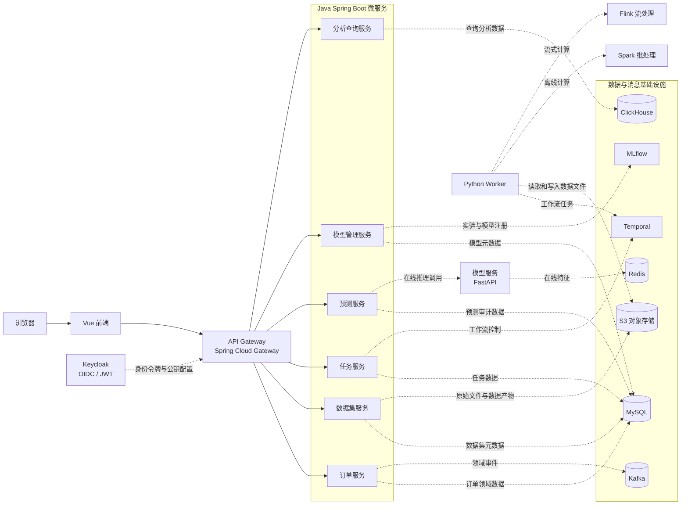

# 当前系统架构设计

## 1. 文档范围

本文描述当前仓库已经确定的系统边界、服务职责、基础设施和代码实现状态。仓库目前主要完成项目骨架与本地运行配置，业务接口和数据处理流程尚未实现；文中会区分架构职责与已落地代码。

## 2. 总体架构

系统采用前后端分离和独立部署的微服务结构。Vue 前端通过 API Gateway 访问 Java 业务服务；Java 服务按业务领域划分并分别拥有数据库。Python 运行时承载模型推理及数据处理任务，离线批计算和实时流计算分别由 Spark 与 Flink 承担。



图中展示的是仓库声明的逻辑职责和依赖关系。当前并非所有服务间调用、消息消费者和计算任务都已有业务代码。

## 3. 服务职责

| 服务或运行单元 | 技术 | 当前职责边界 |
| --- | --- | --- |
| `api-gateway` | Spring Cloud Gateway | 对外统一 API 入口，校验 JWT，并将 `/api/v1/...` 路由到对应 Java 服务。 |
| `order-service` | Spring Boot | 管理订单及订单状态，拥有订单服务数据。 |
| `dataset-service` | Spring Boot | 管理上传文件相关元数据、数据集版本及校验记录。文件内容存放于对象存储。 |
| `job-service` | Spring Boot、Temporal Client | 管理长任务状态并连接 Temporal 工作流服务。 |
| `prediction-service` | Spring Boot | 提供在线预测业务入口、预测记录和审计，并调用模型服务。 |
| `model-management-service` | Spring Boot | 管理模型审核、上线、回滚及版本元数据。 |
| `analytics-query-service` | Spring Boot | 为前端分析看板提供查询 API。 |
| `model-serving` | Python、FastAPI | 独立提供在线模型推理运行时。 |
| Python Worker Pools | Python、Temporal SDK | 承载数据集处理、模型训练和批量预测等异步任务。 |
| Spark / Flink Jobs | PySpark、Flink SQL 或 Java | Spark 执行离线批处理，Flink 执行持续流处理；二者是计算运行时，不是业务微服务。 |

### 服务入口

| 服务 | Compose 内部端口 | 当前可用入口 |
| --- | --- | --- |
| `api-gateway` | `8080` | 宿主机映射为 `http://localhost:8080`；路由 `/api/v1/orders/**`、`/api/v1/datasets/**`、`/api/v1/fields/**`、`/api/v1/rules/**`、`/api/v1/jobs/**`、`/api/v1/predictions/**`、`/api/v1/models/**`、`/api/v1/analytics/**`。 |
| `order-service` | `8081` | Java Actuator 健康检查 `/actuator/health`；Compose 内部服务，默认不映射宿主机端口。 |
| `dataset-service` | `8082` | Java Actuator 健康检查 `/actuator/health`；Compose 内部服务，默认不映射宿主机端口。 |
| `job-service` | `8083` | Java Actuator 健康检查 `/actuator/health`；Compose 内部服务，默认不映射宿主机端口。 |
| `prediction-service` | `8084` | Java Actuator 健康检查 `/actuator/health`；Compose 内部服务，默认不映射宿主机端口。 |
| `model-management-service` | `8085` | Java Actuator 健康检查 `/actuator/health`；Compose 内部服务，默认不映射宿主机端口。 |
| `analytics-query-service` | `8086` | Java Actuator 健康检查 `/actuator/health`；Compose 内部服务，默认不映射宿主机端口。 |
| `model-serving` | `8090` | 宿主机映射为 `http://localhost:8090`；当前有 `/health/live`、`/health/ready` 和 `/metrics`。 |
| Python Worker Pools | 无 HTTP 端口 | 当前只有目录和职责说明，Worker 程序尚未实现。 |

除 Gateway 和模型服务外，Compose 中的 Java 服务端口只在 Compose 网络内开放。直接在本机用 Maven 启动 Java 服务时，可通过对应的 `localhost` 端口访问。

## 4. 数据与基础设施

| 组件 | 当前用途与本地部署方式 |
| --- | --- |
| MySQL 8.4 | Java 服务的关系型数据存储。本地 Compose 使用同一 MySQL 实例，并按服务配置独立数据库，如 `olist_orders`、`olist_datasets`、`olist_jobs`、`olist_predictions`、`olist_models` 和 `olist_analytics`。 |
| Kafka 4.4 | 订单领域事件的消息基础设施。当前 AsyncAPI 契约定义了 `orders.status-changed.v1` 事件。 |
| LocalStack S3 | 本地 S3 兼容对象存储，初始化 `olist-artifacts` 与 `olist-lakehouse` 两个 bucket。文件和模型产物通过对象存储保存，而不是通过消息队列传输。 |
| Temporal 1.29 | 长流程工作流运行时，供任务服务及 Worker 使用。 |
| Redis 7.4 | 在线特征存储基础设施。Python `features` 依赖组包含 Feast/Redis 集成。 |
| ClickHouse 26.10 | 分析查询存储。 |
| MLflow | 实验跟踪及模型注册；通过 `ml` 或 `apps` Compose profile 启动。模型产物存于 S3 兼容存储。 |
| Keycloak 26 | OIDC 身份提供方；Gateway 与 Java 服务配置 JWT 校验。 |
| Mailpit | 本地 SMTP 收件箱；用于查看 Keycloak 发出的邮箱验证和密码重置邮件，不需要短信服务。 |
| Prometheus / Grafana | 通过 `observability` profile 启动，收集与展示服务指标。 |
| Spark 4.1 | 通过 `batch` profile 启动的本地批处理运行时。 |
| Flink 2.3 | 通过 `stream` profile 启动的本地流处理运行时。 |

Kafka 用于可回放的领域事件；Temporal 用于有状态、可重试的长流程编排，两者承担不同职责。

## 5. 代码仓库结构

| 路径 | 内容 |
| --- | --- |
| `ML-Based-Order-Delay-Prediction-System-for-Olist-frontend/` | Vue 前端项目。 |
| `ML-Based-Order-Delay-Prediction-System-for-Olist-java-backend/` | Java Maven 聚合工程，包含 Gateway、业务服务和共享 `platform-runtime` 模块；每个服务模块独立构建镜像。 |
| `ML-Based-Order-Delay-Prediction-System-for-Olist-backend/` | Python FastAPI 模型服务及 Python 应用包。 |
| `contracts/` | 跨服务消息契约，目前包含订单状态事件的 AsyncAPI 定义。 |
| `infra/` | MySQL 初始化、Keycloak Realm、MLflow、Prometheus 和 Grafana 本地配置。 |
| `deploy/helm/` | Kubernetes Helm 部署模板。 |
| `compose.yaml` | 本地基础设施和应用服务编排；Spark、Flink、MLflow、Prometheus/Grafana 按 Compose profile 启动。 |

## 6. 本地启动与运行

### 环境要求

- Docker Desktop 与 Docker Compose
- Java 17
- Node.js 22.18 或更高版本（或 24.12 或更高版本）与 pnpm
- Python 3.11 或更高版本

### 启动基础设施与全部服务

以下命令均从仓库根目录使用 PowerShell 执行：

```powershell
Copy-Item .env.example .env
docker compose up -d
docker compose --profile apps up --build -d
```

第一条 Compose 命令启动 MySQL、Kafka、Redis、LocalStack S3、ClickHouse、Temporal、Keycloak 和 Mailpit 等基础设施。第二条构建并启动 Gateway、全部 Java 服务、MLflow 和 Python 模型服务。首次构建需要下载镜像和依赖。

注册验证码由 Gateway 发出。本地邮件默认进入 Mailpit，可在 `http://localhost:8025` 查看；SMTP 端口 `1025` 也映射到宿主机，供 IDEA 启动 Gateway 使用。Keycloak Realm 禁止内建自助注册，避免绕过验证码 API。Realm JSON 只会在 Realm 首次导入时初始化；已有 `olist` Realm 不需要删除数据卷，但需运行以下初始化脚本同步关闭自助注册、设置 10 位密码策略、创建最小权限客户端，并允许只填写姓名的账号登录：

```powershell
docker compose up -d mysql redis mailpit keycloak
node --env-file=.env infra/keycloak/configure-registration-client.mjs
node --env-file=.env infra/keycloak/configure-user-profile.mjs
```

第一个脚本只授予客户端 `manage-users`、`query-users` 和 `view-users`，并输出生成的 `KEYCLOAK_REGISTRATION_CLIENT_SECRET`。将该值写入根目录 `.env`，同时用 `node -e "console.log(require('node:crypto').randomBytes(32).toString('hex'))"` 生成并填写 `REGISTRATION_OTP_SECRET`，然后重启 Gateway。第二个脚本将姓氏改为选填，并启用 `birthday`、`gender`、`picture` 等自定义属性；否则 Keycloak 会以“账号未完整设置”拒绝登录，且注册时填写的生日和性别会被丢弃。不要提交 `.env` 或把这些值放进前端环境变量。

从 IDEA 或命令行启动 Gateway 时会自动导入根目录 `.env`（见 `application.yml` 中的 `spring.config.import`），Redis、Keycloak 管理 API、注册客户端密钥、OTP 密钥和 SMTP 发件配置都直接读取该文件。使用 QQ SMTP 发真实邮件时，在 `.env` 中设置 `SMTP_HOST=smtp.qq.com`、`SMTP_PORT=465`、`SMTP_AUTH=true`、`SMTP_SSL=true`、`SMTP_STARTTLS=false`，并填写 `SENDER_EMAIL` 和邮箱授权码 `SENDER_PASS`。`infra/keycloak/configure-qq-smtp.mjs` 是 Keycloak 自身邮件服务器的独立配置脚本，会先发送真实测试邮件；注册验证码不依赖它。

常用检查命令：

```powershell
docker compose ps
docker compose logs -f api-gateway dataset-service
```

停止容器但保留本地数据卷：

```powershell
docker compose down
```

### 启动单个 Java 服务

在 Docker Compose 中启动单个服务及其依赖，例如数据集服务：

```powershell
docker compose --profile apps up --build -d dataset-service
```

也可以在本机直接运行。默认配置使用内存 H2 数据库；以下示例从 Java Maven 工程目录启动 `dataset-service`：

```powershell
Set-Location .\ML-Based-Order-Delay-Prediction-System-for-Olist-java-backend
.\mvnw.cmd -pl dataset-service -am spring-boot:run
```

默认 `local` profile 使用文件型 H2（MySQL 兼容模式），零依赖即可启动。需要连接真实 MySQL 时，先在仓库根目录启动 MySQL，再用 `mysql` profile 启动服务：

```powershell
docker compose up -d mysql
Set-Location .\ML-Based-Order-Delay-Prediction-System-for-Olist-java-backend
.\mvnw.cmd -pl dataset-service -am -DskipTests package
java -jar dataset-service\target\dataset-service-0.1.0-SNAPSHOT.jar --spring.profiles.active=mysql
```

Compose 将 MySQL 映射到宿主机 `3307`，`mysql` profile 默认使用 `olist / local-only-change-me`。可以用 `SPRING_DATASOURCE_URL`、`SPRING_DATASOURCE_USERNAME`、`SPRING_DATASOURCE_PASSWORD` 覆盖连接参数。

将 `dataset-service` 替换为 `order-service`、`job-service`、`prediction-service`、`model-management-service` 或 `analytics-query-service`，可运行对应模块。直接运行的模块端口见“服务入口”表。完整 Java 构建与测试：

```powershell
Set-Location .\ML-Based-Order-Delay-Prediction-System-for-Olist-java-backend
.\mvnw.cmd -B test
```

### 单独运行 Python 模型服务

在 Python 工程目录创建虚拟环境、安装轻量运行依赖并启动 FastAPI：

```powershell
Set-Location .\ML-Based-Order-Delay-Prediction-System-for-Olist-backend
py -3.11 -m venv .venv
.\.venv\Scripts\python.exe -m pip install -r requirements.txt
.\.venv\Scripts\python.exe -m uvicorn app.main:app --reload --port 8090
```

健康检查地址为 `http://localhost:8090/health/live` 和 `http://localhost:8090/health/ready`。当前模型服务只提供健康检查和指标端点，预测业务接口尚未实现。

### 启动前端

在前端工程目录执行：

```powershell
Set-Location .\ML-Based-Order-Delay-Prediction-System-for-Olist-frontend
pnpm install
pnpm dev
```

Vite 开发服务器默认位于 `http://localhost:5173`，前端 `/api` 请求代理到本机 Gateway `http://localhost:8080`。运行完整前端联调时，需要同时启动 Compose 中的 Gateway 和对应后端服务。

### 可选运行配置

```powershell
docker compose --profile apps --profile batch up --build -d
docker compose --profile apps --profile stream up --build -d
docker compose --profile observability up -d
```

`batch` 启动 Spark，`stream` 启动 Flink，`observability` 启动 Prometheus 与 Grafana。Grafana 地址为 `http://localhost:3000`，Prometheus 地址为 `http://localhost:9090`。Temporal UI 地址为 `http://localhost:8233`，Keycloak 地址为 `http://localhost:8180`，本地邮件收件箱为 `http://localhost:8025`。

## 7. 当前实现状态

- Java Maven 工程和各服务启动类、基础安全及健康检查配置已经建立；服务模块边界和 Gateway 路由已配置。
- 前端使用邮箱先行的分步登录/注册界面：登录时输入邮箱后进入密码步骤，再通过 Keycloak 密码授权换取 access token（仅本地开发启用 password grant，生产应改用 Authorization Code + PKCE）；注册流程按姓名、生日与性别、密码分步完成。应用只保留这一个登录/注册入口，不再维护额外的 Keycloak 托管登录页；业务 API 使用 Keycloak 签发的 access token。数据集按 JWT `sub` 隔离。
- Java 服务尚未实现订单、任务编排、预测、模型管理或分析查询等业务接口；数据集服务已实现文件上传、版本元数据查询、对象存储写入，以及字段库和清洗规则库的维护接口。
- Python FastAPI 当前提供健康检查与指标基础；模型推理业务和 Temporal Worker 活动尚未实现。
- `app/workers/` 与 `app/pipelines/` 当前包含职责说明，没有实际 Worker 或数据处理任务实现。
- Kafka 基础设施与订单状态事件契约已配置；契约不代表订单事件的生产者和消费者业务逻辑已实现。
- Compose 与 Helm 描述本地及 Kubernetes 运行基础；实际运行时行为仍取决于对应服务代码和环境配置。
